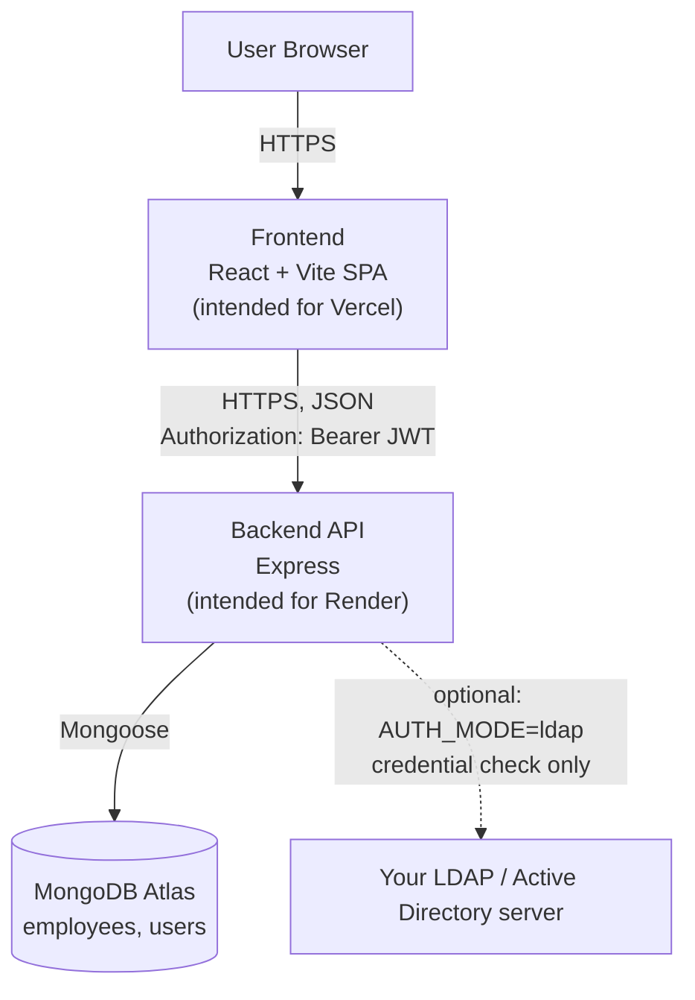
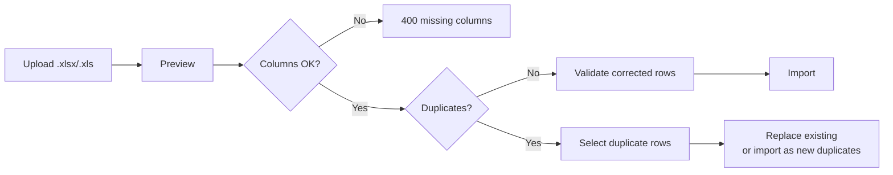

# Employee Directory

A full-stack internal employee directory. Anyone who can reach the site can search the directory; an authenticated **SUPER_ADMIN** can add, edit, delete, and bulk-import employees from Excel files, with duplicate detection and controlled replacement.

## 1. Overview
**Public directory (`/`)**: anyone who can reach the site can search, sort, and page through employees (name, designation, department, company, extension, mobile number, email). No login is required to read employee data.

**Admin portal (`/admin/...`)**: a SUPER_ADMIN logs in to:

- view dashboard statistics
- add, edit, and delete employees (single and bulk)
- import employees from Excel with a preview → correct → validate → import workflow
- change their own password (local authentication mode only)

**Purpose:** maintain and look up internal contact details (extensions and mobile numbers) with duplicate protection.

### Architecture



The repository contains `frontend/vercel.json` (SPA rewrite). It contains **no** `render.yaml`, no GitHub Actions workflows, no Docker configuration, and no other deployment configuration. Render and Atlas setup is documented from `backend/package.json` and `backend/server.js`; see [sections 13–14](#13-deployment-vercel-frontend) for items to confirm in your dashboards.

---

## 2. Technology Stack

| Layer | Technology (from `package.json` / source) |
|---|---|
| Frontend framework | [React](https://react.dev/) 19 |
| Routing | `react-router-dom` 7 (`BrowserRouter`) |
| Build tool / dev server | [Vite](https://vite.dev/) 8 with `@vitejs/plugin-react` |
| Styling | Tailwind CSS 4 via `@tailwindcss/vite` |
| HTTP client | `axios` |
| Linting | ESLint 10 (react-hooks, react-refresh plugins) |
| Backend framework | Express 5 (CommonJS) |
| Database | [MongoDB](https://www.mongodb.com/docs/atlas/) (Atlas expected) |
| ODM | Mongoose 9 |
| Authentication | JWT (`jsonwebtoken`) + `bcryptjs`; optional LDAP via `ldapjs` |
| Excel import | `xlsx` (reading), `multer` (uploads) |
| Security middleware | `helmet`, `cors`, `express-rate-limit` (login route only) |
| Other backend deps | `dotenv`, `cookie-parser` (registered, but no cookies are read or set in the code) |
| Dev tooling | `nodemon` (backend `dev` script) |
| Deployment targets | [Vercel](https://vercel.com/docs) (frontend, `vercel.json` present); [Render](https://render.com/docs) + MongoDB Atlas (backend/database, **not configured in the repo**) |

**Not used:** TypeScript, any test framework, Docker, CI workflows.

---

## 3. Repository Structure

```text
employee-directory/
├── .gitignore                      # ignores node_modules, .env*, dist/build, uploads/*, logs
├── backend/
│   ├── .env.example                # backend variable names (no secrets)
│   ├── package.json                # scripts: start, dev
│   ├── server.js                   # entry point: env checks, middleware, routes, DB connect, listen
│   ├── config/db.js                # Mongoose connection (database name is hard-coded here)
│   ├── models/
│   │   ├── Employee.js             # employee schema
│   │   └── User.js                 # admin user schema (role enum: SUPER_ADMIN only)
│   ├── routes/
│   │   ├── employeeRoutes.js       # /api/employees
│   │   ├── authRoutes.js           # /api/auth
│   │   ├── adminRoutes.js          # /api/admin
│   │   └── importRoutes.js         # /api/import (multer upload config lives here)
│   ├── controllers/                # business logic: employee, auth, admin, import
│   ├── middleware/
│   │   ├── authMiddleware.js       # `protect` – verifies Bearer JWT
│   │   └── roleMiddleware.js       # `superAdminOnly` – requires role SUPER_ADMIN
│   ├── services/ldapService.js     # LDAP authentication (used only when AUTH_MODE=ldap)
│   ├── uploads/.gitkeep            # keeps the temp upload folder in git
│   └── checkCompanies.js           # manual diagnostic script (see section 18)
└── frontend/
    ├── .env.example                # VITE_API_URL
    ├── package.json                # scripts: dev, build, lint, preview
    ├── vite.config.js              # react + tailwind plugins only
    ├── vercel.json                 # rewrites every path to /index.html (SPA routing)
    ├── eslint.config.js
    ├── index.html
    ├── README.md                   # unmodified Vite template text (not project docs)
    ├── public/                     # favicon.svg, icons.svg
    └── src/
        ├── main.jsx                # React entry
        ├── api.js                  # axios instance (baseURL = VITE_API_URL) + 401 handler
        ├── App.jsx                 # router + PublicDirectory, AdminLogin, ProtectedRoute,
        │                           #   AdminDashboard, AdminImport (all in one file)
        └── pages/
            ├── AdminEmployees.jsx  # admin list, search, sort, select, bulk delete
            ├── AddEmployee.jsx     # add form + duplicate modal (Replace / Add Anyway)
            ├── EditEmployee.jsx    # edit / delete one employee
            └── ChangePassword.jsx
```

> **Important:** keep `backend/uploads/.gitkeep`. `multer` is configured with a function destination (`backend/routes/importRoutes.js`), so it does not create the folder itself. If `backend/uploads/` is missing on the server, Excel preview/import fails.

---

## 4. Prerequisites

| Requirement | Detail |
|---|---|
| [Node.js](https://nodejs.org/) | The repo declares **no** `engines` field and no `.nvmrc`. Locked dependencies require at least: Mongoose 9 → Node `>=20.19.0`; Vite 8 → `^20.19.0 \|\| >=22.12.0`; ESLint 10 → `^20.19.0 \|\| ^22.13.0 \|\| >=24`. **Use Node 20.19+ (or 22.13+).** |
| [npm](https://docs.npmjs.com/) | Both apps ship a `package-lock.json`, so npm is the package manager in use. |
| Git | To clone and push. |
| [MongoDB Atlas](https://www.mongodb.com/docs/atlas/) | An Atlas cluster and database user ([section 7](#7-mongodb-atlas-configuration)). A local MongoDB may also work if `MONGO_URI` points to it. **Developer must confirm this**; the code was written for Atlas. |
| Vercel account | For frontend hosting. |
| Render account | For backend hosting. |
| LDAP details from your IT team | Only if enabling `AUTH_MODE=ldap` ([section 16](#16-ldap--active-directory)). |

---

## 5. Getting Started

The repository has two independent npm projects: `backend/` and `frontend/`. There is **no root `package.json`**; run npm commands inside each folder.

### Clone

```bash
git clone https://github.com/sarjnapandya-max/employee-directory.git
cd employee-directory
```

### Backend

```bash
cd backend
npm install                 # or: npm ci
cp .env.example .env        # then set MONGO_URI and JWT_SECRET (>= 32 chars)
npm run dev                 # or: npm start
```

| Command | What it does |
|---|---|
| `npm start` | `node server.js` (use this in production) |
| `npm run dev` | `nodemon server.js` (auto-restart for local development) |

There is no build step and no `test` script in the backend.

Expected log lines: `Server running on http://0.0.0.0:5000` and `MongoDB connected: …`.

Quick check: `http://localhost:5000/api/health` should return JSON with `"success": true` and a message that the backend is running.

### Frontend

```bash
cd frontend
npm install                 # or: npm ci
cp .env.example .env        # default VITE_API_URL=http://localhost:5000/api
npm run dev
```

| Command | What it does |
|---|---|
| `npm run dev` | Starts the Vite dev server (default `http://localhost:5173`; no port override in `vite.config.js`) |
| `npm run build` | `vite build` → output in `frontend/dist/` |
| `npm run preview` | Serves the built `dist/` locally |
| `npm run lint` | `eslint .` (see [section 19](#19-development-and-maintenance-workflow) for known lint status) |

### Local URLs

| What | URL |
|---|---|
| Public directory | `http://localhost:5173/` |
| Admin login | `http://localhost:5173/admin/login` |
| API base used by the frontend | `VITE_API_URL` → `http://localhost:5000/api` |

For CORS to work locally, `FRONTEND_URL` in `backend/.env` must equal the exact origin the browser uses (`http://localhost:5173`, which is also the default if unset).

### Frontend Routes (`src/App.jsx`)

| Path | Access |
|---|---|
| `/` | Public directory |
| `/admin/login` | Login page |
| `/admin/dashboard` | Requires stored token |
| `/admin/employees` | Requires stored token |
| `/admin/employees/add` | Requires stored token |
| `/admin/employees/edit/:id` | Requires stored token |
| `/admin/import` | Requires stored token |
| `/admin/change-password` | Requires stored token |

---

## 6. Environment Variables

Every variable below was found by searching the source for `process.env` / `import.meta.env`.

| Variable | Where | Required? | Purpose | Placeholder |
|---|---|---|---|---|
| `MONGO_URI` | Backend | **Yes** | MongoDB connection string used by `config/db.js` (and `checkCompanies.js`). If missing or invalid, the server logs `MongoDB connection failed:` and exits. | `YOUR_MONGODB_CONNECTION_STRING` |
| `JWT_SECRET` | Backend | **Yes** | Signs/verifies login tokens. `server.js` exits at startup if it is missing or **shorter than 32 characters**. | `YOUR_JWT_SECRET` (≥ 32 chars) |
| `PORT` | Backend | No (default `5000`) | HTTP port. The server binds to `0.0.0.0`. Hosting platforms typically inject their own value. | `5000` |
| `FRONTEND_URL` | Backend | Effectively yes in production (default `http://localhost:5173`) | The **single** allowed CORS origin. | https://your-frontend-domain.example in production |
| `AUTH_MODE` | Backend | No (default `local`) | `local` = username/password stored in MongoDB; `ldap` = verify password against LDAP ([section 16](#16-ldap--active-directory)). Any other value → login returns `Unsupported authentication mode`. | `local` |
| `LDAP_URL` | Backend | Only if `AUTH_MODE=ldap` | LDAP server host/URL. `ldap://` is prepended if no protocol is given. | `YOUR_LDAP_URL` |
| `LDAP_PORT` | Backend | Only if `AUTH_MODE=ldap` | Appended to `LDAP_URL` if the URL has no port. | `389` |
| `LDAP_BIND_DN` | Backend | Only if `AUTH_MODE=ldap` | Service account DN used to search for the user. | `YOUR_LDAP_BIND_DN` |
| `LDAP_BIND_PASSWORD` | Backend | Only if `AUTH_MODE=ldap` | Service account password. **Secret.** | `YOUR_LDAP_BIND_PASSWORD` |
| `LDAP_USER_SEARCH_BASE` | Backend | One of this or `LDAP_BASE_DN` | Search base for user lookup (takes precedence). | `YOUR_LDAP_USER_SEARCH_BASE` |
| `LDAP_BASE_DN` | Backend | One of this or `LDAP_USER_SEARCH_BASE` | Fallback search base. | `YOUR_LDAP_BASE_DN` |
| `LDAP_USER_SEARCH_FILTER` | Backend | Only if `AUTH_MODE=ldap` | Filter containing `{username}` (for example, the `(sAMAccountName={username})` pattern shown in a code comment). | `YOUR_LDAP_USER_SEARCH_FILTER` |
| `NODE_ENV` | Backend | No | Listed in `backend/.env.example`, but **not read by application code** (Express/libraries may read it internally). | `development` |
| `VITE_API_URL` | Frontend | **Yes** | Base URL of the backend API **including the `/api` suffix**. Used by `src/api.js` and direct `axios` calls. | `http://localhost:5000/api` locally; `https://your-backend-domain.example/api` in production |

### Where to Set Them

| Environment | Location |
|---|---|
| Local backend | `backend/.env` (copy of `backend/.env.example`) |
| Local frontend | `frontend/.env` (copy of `frontend/.env.example`) |
| Vercel | Project → **Settings → Environment Variables** |
| Render | Service → **Environment** tab |

> ⚠️ **Never commit `.env` files.** `.gitignore` already ignores `.env` and `.env.*` (but allows `.env.example`). Only put placeholders in `.env.example`.

> ⚠️ `VITE_*` variables are **inlined at build time** by Vite and are **visible in the browser**. Never put secrets in them. After changing `VITE_API_URL` on Vercel you must **redeploy** the frontend.

### Local vs. Production

| Variable | Local | Production |
|---|---|---|
| `VITE_API_URL` | `http://localhost:5000/api` | `https://your-backend-domain.example/api` (rebuild required) |
| `FRONTEND_URL` | `http://localhost:5173` | https://your-frontend-domain.example (scheme included, **no trailing slash**) |
| `MONGO_URI` | Development database string | Production Atlas string. The database name is hard-coded (see [section 7](#7-mongodb-atlas-configuration)), so use separate clusters or users if you need environment isolation. |
| `JWT_SECRET` | Throw-away dev value | A different, private production value |

CORS allows exactly **one** origin. A Vercel preview URL will be rejected unless `FRONTEND_URL` is set to it.

---

## 7. MongoDB Atlas Configuration

### How the Backend Connects

`backend/config/db.js` connects with a **hard-coded database name** passed through the `dbName` option:

```js
mongoose.connect(process.env.MONGO_URI, { dbName: "<hard-coded-database-name>" });
```

- Because it is applied via `dbName`, it takes effect regardless of any database name in the URI.
- On success the server logs `MongoDB connected: <host>` and the database name.
- On failure the process logs `MongoDB connection failed: <reason>` and exits with code 1.
- The HTTP server starts listening immediately and the DB connects in parallel; there is no retry logic.

Check `backend/config/db.js` for the current database name, and change it there if your deployment needs a different one.

### Setup Steps

1. Create an Atlas cluster (tier/region: **Developer must configure/confirm this**).
2. **Database Access:** create a database user with a strong password and the least privilege that allows read/write on the application database.
3. **Network Access:** allow the IP addresses the backend connects from.
   - Local development: your own IP.
   - Hosted backend: use the platform's outbound IP addresses (**Developer must confirm** the current values in your host's documentation/dashboard), or, as a conscious trade-off, allow `0.0.0.0/0` and rely on a strong database password. Prefer the narrower option.
4. **Connect → Drivers:** copy the `mongodb+srv://…` connection string into `MONGO_URI`. URL-encode special characters in the password.
5. Never paste the real string into the README, issues, or commit history.

### Collections and Indexes

- Models: `Employee` → `employees`; `User` → `users` (Mongoose default pluralization).
- The code does not disable Mongoose's default `autoCreate` / `autoIndex`, so collections and indexes defined in schemas are created automatically. The only explicit index is `unique` on `User.username`. `Employee` has no explicit indexes.
- There is **no seed or migration script**. A new database starts empty, including `users`, so the first admin must be created manually ([section 8](#8-authentication-and-admin-access)).

---

## 8. Authentication and Admin Access

### Login Flow

1. The login page posts `{ username, password }` to `POST /api/auth/login`.
2. In `AUTH_MODE=local` (default), the backend finds the `User` by `username`, compares the password with `bcryptjs` against `passwordHash`, and on success returns a JWT (`expiresIn: 1h`) containing `userId`, `username`, and `role`.
3. The frontend stores the token and user object in browser `localStorage`, then navigates to `/admin/dashboard`.
4. Protected API calls send `Authorization: Bearer <token>`.
5. On a `401`, the frontend clears the stored values and redirects to `/admin/login`. Tokens expire after 1 hour.

### Authorization

- `protect` (`middleware/authMiddleware.js`): requires a valid Bearer JWT, else `401`.
- `superAdminOnly` (`middleware/roleMiddleware.js`): requires `req.user.role === "SUPER_ADMIN"`, else `403 SUPER_ADMIN access required`.
- The frontend `ProtectedRoute` only checks that a token **exists** in `localStorage`; it does not validate it. Real enforcement is on the server.
- The `User` schema's `role` enum contains only `SUPER_ADMIN`, so every user is a super admin and the `403` from `superAdminOnly` cannot normally be triggered through this schema.

### Login Rate Limit

`POST /api/auth/login` allows **5 requests per 15 minutes** per client (`express-rate-limit`). Exceeding it returns *"Too many login attempts. Please try again later."*

> ⚠️ **Observation:** the code does not call `app.set("trust proxy", …)`. Behind a reverse proxy (as on Render), the limiter may count requests by the proxy's address and/or log an `express-rate-limit` proxy warning. **Developer must confirm this behavior in production.**

### Admin Bootstrap (Important)

The repository contains **no admin-creation script, seed script, or registration endpoint**. The first admin must be inserted manually into the `users` collection. A user document has this shape:

```json
{
  "username": "YOUR_ADMIN_USERNAME",
  "passwordHash": "<bcrypt hash of the password>",
  "role": "SUPER_ADMIN"
}
```

- For `AUTH_MODE=local`, `passwordHash` must be a bcrypt hash (the app uses `bcryptjs`, cost 10, when changing passwords). Generate it with your own tooling. Never store plaintext passwords or commit real passwords/hashes.
- For `AUTH_MODE=ldap`, the password is verified by LDAP, but a matching `users` document with `role: "SUPER_ADMIN"` is still required (otherwise the response is `403 … not authorized for admin access`). `passwordHash` is optional in the schema.
- Any bootstrap scripts you write are **local-only** (see [section 18](#18-files-that-must-not-be-committed)). If used against production, delete the script and clear shell history afterward.

### Change Password

`/admin/change-password` → `PUT /api/auth/change-password`

- Works only when `AUTH_MODE=local` (otherwise `403`).
- Requires current password, new password, and confirmation. The new password must differ from the current one and match the confirmation.
- No minimum-length or complexity rule was found in the code.

---

## 9. Employee Management

### Employee Fields (`models/Employee.js`)

`employeeName`, `designation`, `department`, `company`, `extension`, `mobileNo` (all required, trimmed strings) and `email` (optional, trimmed, lower-cased). Timestamps are added automatically.

### Listing, Search, and Filtering

`GET /api/employees` (public)

| Query param | Behavior |
|---|---|
| `search` | Case-insensitive match across `employeeName`, `designation`, `department`, `company`, `extension`, `mobileNo`, `email` |
| `sortBy` | One of `employeeName` (default), `designation`, `department`, `company`, `extension`, `mobileNo`; anything else falls back to `employeeName` |
| `sortOrder` | `asc` (default) or `desc` |
| `page` | Default 1 |
| `limit` | Default 10, maximum 100. The public page offers 10/25/50/100 (default 25); the admin list uses 10 per page |

> ⚠️ **Known behavior:** the `search` text is passed to `new RegExp(search.trim(), "i")` without escaping, so it is interpreted as a regular expression. Input such as `(` is an invalid regex and results in a `500 Failed to fetch employees`. This is documented as current behavior.

### Adding

`/admin/employees/add` → `POST /api/employees` (SUPER_ADMIN)

- All fields except email are required. Missing fields → `400` with `missingFields`.
- `mobileNo` must be **exactly 10 digits** (`/^\d{10}$/`) on the backend.
- Email has no format validation in the backend.
- If a duplicate is found, the API returns `409` with `duplicateDetected: true`, the list of `duplicates`, and `matchingEmployees`. The UI shows a modal with **Replace Existing** and **Add Employee Anyway** ([section 11](#11-duplicate-detection-rules)).

### Editing

`/admin/employees/edit/:id` → `PUT /api/employees/:id` (SUPER_ADMIN)

- Same required fields and 10-digit mobile rule. Submitting an empty email **clears** the stored email.
- New values are checked against **other** employees. A collision returns `409` with `conflicts`; there is no "save anyway" override on edit.

### Deleting

`DELETE /api/employees/:id` and `DELETE /api/employees/bulk-delete` (body `{ "ids": [...] }`), both SUPER_ADMIN. Deletion is **permanent** (hard delete). The admin list has row checkboxes and a **Delete Selected** button.

### Dashboard

`/admin/dashboard` → `GET /api/admin/stats` (SUPER_ADMIN): total employees, total departments, total companies, plus per-department and per-company counts and an employee list.

---

## 10. Excel Import

All import endpoints require a valid token **and** SUPER_ADMIN. The UI (`/admin/import`) uses them in this order:



1. **Upload / Preview:** the admin selects a `.xlsx` or `.xls` file (max **5 MB**) and clicks **Preview Excel** → `POST /api/import/preview` (multipart field `file`). The backend reads the **first sheet only**, deletes the temporary file afterward, and returns the rows as JSON.
2. **Column check:** header names are trimmed and internal whitespace is collapsed; matching is otherwise **case-sensitive**. Accepted headers:

   | Field | Accepted header(s) | Required |
   |---|---|---|
   | Employee name | `Employee Name` **or** `Name of the Employee` | Yes |
   | Designation | `Designation` | Yes |
   | Department | `Department` | Yes |
   | Company | `Company` | Yes |
   | Extension | `Extension` **or** `New Ext.` | Yes |
   | Mobile | `Mobile No` | Yes |
   | Email | `Email` | No (column may be absent) |

   Missing columns → `400 Excel file has missing required columns.` with `missingColumns`.
3. **Duplicate detection at preview:** duplicates inside the file and against MongoDB are checked ([section 11](#11-duplicate-detection-rules)). If duplicates exist the response is `400` but **still includes the rows**, so the UI can highlight them.
4. **Row correction:** the admin can click **Edit Row N** (Excel row numbers: header = row 1, first data row = row 2), change values, and re-validate → `POST /api/import/validate-corrected` with `{ rows }`. This checks required fields, mobile format, and duplicates again.
5. **Value validation:** on validate/import, every row needs all required fields, and `mobileNo` must be **10 or 11 digits** (`/^\d{10,11}$/`). This differs from the manual Add/Edit forms, which require exactly 10 digits. Preview itself reports column and duplicate problems only.
6. **Clean import:** when no duplicates or errors remain, **Import** → `POST /api/import/import-corrected` with `{ rows }`. All rows are validated and duplicate-checked first; nothing is created if any problem remains. Rows are then created one by one **without a database transaction**.
7. **Duplicate handling:** when duplicates exist, the admin can select duplicate rows and choose:
   - **Replace Selected Existing Records:** for each selected row, pick the existing employee to overwrite from a dropdown that lists every matched record, so ambiguous matches are resolved explicitly. Rows that only duplicate *other Excel rows* have no existing employee to select and must be corrected or imported as intentional duplicates. Call: `POST /api/import/import-duplicates` with `{ rows, rowNumbers, replaceMappings, forceDuplicateImport: true }`.
   - **Upload Selected Duplicates (n):** saves the selected duplicate rows as **new, separate** records (intentional duplicates), via the same endpoint without `replaceMappings`.
   - In both cases all non-duplicate rows in the file are also imported, a browser confirmation dialog is shown first, and unselected duplicate rows are skipped.

### Sample Data for Testing

Use obviously fictional data when testing imports. Never commit real employee files.

| Employee Name | Designation | Department | Company | Extension | Mobile No | Email |
|---|---|---|---|---|---|---|
| John Doe | Engineering Manager | Example Department | Example Company | 1001 | 9000000001 | john.doe@example.com |
| Jane Smith | Analyst | Example Department | Example Company | 1002 | 9000000002 | jane.smith@example.com |

### Replacement Details

`forceDuplicateImport` must be exactly `true`. The mapped employee is looked up by its Mongo `_id` (invalid → `400`, not found → `404`). Before overwriting, the Excel row's name/extension/mobile/email are checked against **other** employees; a collision returns `409 Cannot replace row N: …`. A replacement overwrites all seven fields; a blank Excel email clears the stored email.

### Endpoints Not Used by the Current UI

- `POST /api/import/upload` saves the file and returns its details. The uploaded file is **not** deleted by this endpoint.
- `POST /api/import/import` performs a direct file import with the same validation and duplicate blocking.

> ⚠️ Excel files contain employee data. Handle uploaded files according to your organization's data-protection policies.

---

## 11. Duplicate Detection Rules

**Fields checked:** employee name, extension, mobile number, and email (email only when provided). Matching is **exact** after trimming, not fuzzy or partial.

| Field | Manual add (`POST /api/employees`) | Excel vs. database | Within the Excel file |
|---|---|---|---|
| Employee name | exact, **case-insensitive** | exact, **case-insensitive** | exact, case-insensitive (trimmed) |
| Extension | exact, **case-insensitive** | exact, **case-sensitive** | exact, case-insensitive (trimmed) |
| Mobile number | exact | exact | exact (trimmed) |
| Email | exact, case-insensitive (skipped if blank) | exact, case-insensitive (skipped if blank) | exact, case-insensitive (blank ignored) |
| Name + Company | n/a | n/a | extra check: same name **and** same company in more than one row |

Additional confirmed behavior:

- A record that matches on **any one** field is reported as a duplicate (not all four).
- Multiple existing employees can match (up to 100 per field). All are returned so the admin can choose which one to replace.
- Excel row numbers in messages are spreadsheet row numbers (header = 1).
- Special characters in names/emails are regex-escaped for duplicate lookups.
- Editing a record (`PUT`) checks the new values against *other* records only.

### Detection vs. Replace vs. Add Anyway

| Action | What it does |
|---|---|
| **Duplicate detection** | Automatic. Blocks the save and shows the matching existing record(s). Nothing is written. |
| **Replace Existing** | The admin picks one matching existing employee; the form values **overwrite that record** (`PUT /api/employees/:id`). No new record is created. The overwrite is rejected if the new values also collide with a *different* record. |
| **Add Employee Anyway** | Resends the create request with `allowDuplicate: true`, which **skips all duplicate checks** and creates a new record, intentionally leaving two records with the same name/extension/mobile/email. |

---

## 12. API Reference

Base URL: `https://your-backend-domain.example` (local: `http://localhost:5000`). Defined in `backend/server.js` and `backend/routes/*`.

| Method | Endpoint | Auth | Purpose |
|---|---|---|---|
| GET | `/api/health` | None | Health check |
| POST | `/api/auth/login` | None (rate-limited: 5 / 15 min) | Log in; returns JWT |
| PUT | `/api/auth/change-password` | Bearer JWT | Change own password (`AUTH_MODE=local` only) |
| GET | `/api/employees` | None | List/search/sort/paginate employees |
| GET | `/api/employees/:id` | None | Get one employee |
| POST | `/api/employees` | SUPER_ADMIN | Create employee (409 on duplicate unless `allowDuplicate: true`) |
| PUT | `/api/employees/:id` | SUPER_ADMIN | Update/replace an employee |
| DELETE | `/api/employees/bulk-delete` | SUPER_ADMIN | Delete many (`{ "ids": [...] }`) |
| DELETE | `/api/employees/:id` | SUPER_ADMIN | Delete one |
| GET | `/api/admin/stats` | SUPER_ADMIN | Dashboard statistics |
| POST | `/api/import/preview` | SUPER_ADMIN | Parse Excel (`file`), check columns and duplicates |
| POST | `/api/import/validate-corrected` | SUPER_ADMIN | Re-validate corrected rows (`{ rows }`) |
| POST | `/api/import/import-corrected` | SUPER_ADMIN | Import validated, duplicate-free rows (`{ rows }`) |
| POST | `/api/import/import-duplicates` | SUPER_ADMIN | Import non-duplicates and replace/duplicate-create selected rows |
| POST | `/api/import/upload` | SUPER_ADMIN | Upload only (not used by the UI) |
| POST | `/api/import/import` | SUPER_ADMIN | Direct Excel import (not used by the UI) |

"SUPER_ADMIN" means `protect` + `superAdminOnly` (a valid Bearer token whose role is `SUPER_ADMIN`). Error responses use `{ "success": false, "message": "…" }`. Upload limits: `.xlsx`/`.xls` only, 5 MB.

> ⚠️ **The employee list and single-employee endpoints are public** and return email and mobile number to any caller. This is the current behavior of the application. Place the app behind network controls if that is not acceptable for your use case.

---

## 13. Deployment: Vercel (Frontend)

Settings are derived from `frontend/package.json`, `frontend/vite.config.js`, and `frontend/vercel.json`. See the [Vercel documentation](https://vercel.com/docs).

1. **Connect GitHub:** Vercel dashboard → **Add New… → Project** → import your repository.
2. **Root Directory:** set to **`frontend`** (the repo root has no `package.json`).
3. **Build settings:**

   | Setting | Value |
   |---|---|
   | Framework Preset | Vite (normally auto-detected from `frontend/`; confirm) |
   | Install Command | default (`npm install`) |
   | Build Command | `npm run build` (runs `vite build`) |
   | Output Directory | `dist` (Vite default; `vite.config.js` sets no `outDir`) |

4. **Environment variables:** add `VITE_API_URL` = `https://your-backend-domain.example/api` (must include `/api`, no trailing slash). Apply to Production (and Preview if used).
5. **Deploy.**
6. **Verify:** open the deployed URL, then open `/admin/login` **directly** and refresh a deep link such as `/admin/employees`; it must not 404. `frontend/vercel.json` rewrites every path to `/index.html`, which makes client-side routing work.
7. **Set the backend CORS origin:** copy the final frontend URL into `FRONTEND_URL` on the backend host ([section 14](#14-deployment-render-backend)) and restart/redeploy the backend.
8. **Future deployments:** with the standard Vercel–GitHub integration, a push to the project's Production Branch triggers a production deployment. **Developer must confirm** in Vercel → Settings → Git which branch is the Production Branch; the repo contains no deployment config to prove this.

---

## 14. Deployment: Render (Backend)

There is no `render.yaml` in the repo. The values below come from `backend/package.json` and `backend/server.js`; confirm them in the [Render dashboard](https://render.com/docs).

1. **Create Web Service:** Render dashboard → **New → Web Service**.
2. **Connect GitHub:** select your repository and deployment branch.
3. **Root Directory:** `backend`.
4. **Runtime:** Node (a version satisfying [section 4](#4-prerequisites)). **Developer must confirm** how the Node version is selected in your Render service, since the repo pins none.
5. **Build Command:** `npm install` (there is no build step; `npm ci` also works because `package-lock.json` is committed).
6. **Start Command:** `npm start` (runs `node server.js`).
7. **Environment variables:** add `MONGO_URI`, `JWT_SECRET` (≥ 32 chars), `FRONTEND_URL`, and `AUTH_MODE` (plus `LDAP_*` variables only for LDAP). Do **not** set `PORT` unless required; the app reads `process.env.PORT` and binds `0.0.0.0`.
8. **Deploy.**
9. **Verify:** open `https://your-backend-domain.example/api/health`. It should return JSON with `"success": true`. Logs should show `Server running on http://0.0.0.0:<port>` and `MongoDB connected: …`. You may optionally set `/api/health` as the health check path.
10. **Future deployments:** auto-deploy on new commits is a Render service setting (the repo configures nothing). **Developer must confirm** that Auto-Deploy is enabled for the intended branch.

The service filesystem is used only for short-lived Excel temp files in `backend/uploads/` (deleted after preview/import). No persistent disk is needed by the code.

---

## 15. Production Verification

Run after every deployment. Use clearly named test data and delete it afterward.

```bash
# Backend is up
curl https://your-backend-domain.example/api/health

# Protected route rejects anonymous access (expect HTTP 401)
curl -i https://your-backend-domain.example/api/admin/stats
```

- [ ] `GET /api/health` returns `success: true`
- [ ] Frontend loads and a refresh on `/admin/login` does not 404
- [ ] No CORS errors in browser dev tools on the directory page
- [ ] Directory loads without login; search, sorting, page size, and pagination work
- [ ] Login works with a valid admin; a wrong password is rejected
- [ ] Dashboard shows totals
- [ ] Anonymous request to a protected endpoint returns `401`
- [ ] Add Employee works (10-digit mobile); Edit Employee works
- [ ] Duplicate detection shows the modal when re-adding the same name/extension/mobile
- [ ] **Replace Existing** works and does not create a second record
- [ ] **Add Employee Anyway** creates a second record (then delete it)
- [ ] Excel upload and **Preview Excel** work
- [ ] Excel validation flags a row with a bad mobile number
- [ ] Excel duplicate detection works (in-file and against existing data)
- [ ] Excel **Replace Selected Existing Records** and **Upload Selected Duplicates** work
- [ ] Change Password works (only when `AUTH_MODE=local`)
- [ ] Database changes are reflected in Atlas (`employees` collection)
- [ ] Test records created during the smoke test are deleted

> The SUPER_ADMIN `403` path cannot normally be exercised, because `SUPER_ADMIN` is the only role in the `User` schema; protection is verified through the `401` check above.

---

## 16. LDAP / Active Directory

**Status: code exists and is disabled by default. Production use requires configuration and testing with your own directory.**

- `AUTH_MODE` defaults to `local`. LDAP is used only when `AUTH_MODE=ldap`.
- `backend/services/ldapService.js` implements a search-then-bind flow: bind with a service account (`LDAP_BIND_DN` / `LDAP_BIND_PASSWORD`), find the user's DN with `LDAP_USER_SEARCH_FILTER` (`{username}` is substituted, special characters escaped), then bind as that DN with the user's password. Exactly one match is required.
- After LDAP succeeds, MongoDB is still consulted: the username must exist in `users` with `role: "SUPER_ADMIN"`, otherwise login returns `403`.
- In LDAP mode the local change-password endpoint is disabled.
- Missing LDAP settings return `500 LDAP authentication is not configured.`
- `LDAP_URL` is prefixed with `ldap://` when no protocol is given. Use an explicit `ldaps://…` URL if your IT team requires TLS; the code sets no extra TLS options.
- **Not determinable from the repository:** whether this flow has been tested against a real directory, and the correct values for the LDAP variables. **Developer must configure/confirm this with your organization's IT team.** Do not enable `AUTH_MODE=ldap` in production until the settings are supplied and the flow has been tested.

See the [LDAP overview](https://ldap.com/) and your directory vendor's documentation for server-specific details.

---

## 17. Security Notes

- Never commit `.env` files (`backend/.env`, `frontend/.env`). Only `.env.example` files with empty/placeholder values belong in Git.
- Never commit passwords, password hashes, JWT secrets, MongoDB connection strings, or `LDAP_BIND_PASSWORD`.
- Never commit real employee data (spreadsheets, exports, screenshots). Use fictional sample data for testing.
- Keep `JWT_SECRET` private, ≥ 32 characters, and different between environments. Changing it invalidates all existing tokens.
- Configure production secrets only in your hosting dashboards. `VITE_*` variables are public; never put a secret in one.
- Restrict MongoDB Atlas **Network Access** to the IPs that need it, and use a dedicated database user with minimal permissions.
- Do not commit debugging/bootstrap scripts that contain credentials; remove credentials from shell history after use.
- Do not use development credentials in production. Rotate any credential that was ever committed or shared.
- Admin tokens are stored in browser `localStorage` and last 1 hour. `localStorage` is readable by any script running on the page, so an XSS vulnerability would expose the token.
- The backend uses `helmet` and a single-origin CORS policy; keep `FRONTEND_URL` exact.
- Excel uploads are limited to `.xlsx`/`.xls` and 5 MB.
- Public employee endpoints expose all employee fields without authentication (see [section 12](#12-api-reference)).

---

## 18. Files That Must Not Be Committed

Already ignored by `.gitignore`: `.env`, `.env.*` (except `.env.example`), `node_modules/`, `dist/`, `build/`, `backend/uploads/*` (except `.gitkeep`), logs, and OS files.

| File | Purpose | Commit it? |
|---|---|---|
| `backend/.env.example`, `frontend/.env.example` | Variable-name templates, no secrets | **Yes** (placeholders only) |
| `backend/uploads/.gitkeep` | Keeps the upload folder present | **Yes**, required ([section 3](#3-repository-structure)) |
| `backend/checkCompanies.js` | Manual diagnostic that prints distinct `company` values. Contains no credentials; reads `MONGO_URI` from `.env`. **It does not set the `dbName` option**, so it queries whichever database the URI selects; include the application database name in the URI when running it. Run with `node checkCompanies.js` from `backend/`. | Already committed; not used by the app |
| `frontend/README.md` | Unmodified Vite template text | Already committed; not project documentation |

Not present in the repository and not covered by `.gitignore`, so keep them **local-only** if they exist on a developer machine:

- **Admin creation / bootstrap scripts**: they contain or need an admin password.
- **LDAP / Active Directory test scripts**: they would contain a bind DN/password or real usernames.
- **Real employee spreadsheets or exports.**
- **Temporary diff/patch files** and any file containing connection strings or credentials.

Check `git status` carefully before every commit and add files by name.

---

## 19. Development and Maintenance Workflow

1. **Branch:** `git checkout -b my-change`.
2. **Test locally:** run backend and frontend per [section 5](#5-getting-started) and exercise the changed feature.
3. **Run build/syntax checks:**

```bash
   # Frontend
   cd frontend
   npm run build
   npm run lint

   # Backend (no build/test scripts exist; syntax-check what you changed)
   cd ../backend
   node --check server.js
   node --check controllers/importController.js   # example: any file you edited
```

   > **Current lint status:** at the time this documentation was written, `npm run lint` reported **3 errors and 1 warning** that already existed (unused variables `errorDetails`, `handleSearch`, `token` in `src/App.jsx`; a `react-hooks/exhaustive-deps` warning in `src/pages/AdminEmployees.jsx`). They do not affect `npm run build`. Re-run lint to confirm the current state, and do not add new lint problems. **There are no automated tests.**

4. **Commit only intended files** (avoid `git add .`):

```bash
   git status
   git diff
   git add path/to/changed-file1 path/to/changed-file2
   git commit -m "Describe the change"
```

5. **Push:** `git push origin <branch>`.
6. **Verify the frontend deployment** in your Vercel dashboard and open the site.
7. **Verify the backend deployment** in your Render dashboard (logs show `MongoDB connected`, and `/api/health` responds).
8. **Run the [production verification](#15-production-verification).**

If you change `VITE_API_URL`, redeploy the frontend. If you change `FRONTEND_URL`, restart/redeploy the backend.

---

## 20. Troubleshooting

| Symptom | Likely cause / fix (based on this code) |
|---|---|
| Directory shows *"Unable to load employee directory."* | Backend unreachable or CORS blocked. Check `VITE_API_URL`, backend service status, and `/api/health`. |
| Requests go to a URL containing the word `undefined` | `VITE_API_URL` was not set when the frontend was built. Set it and rebuild/restart. |
| Browser console shows a CORS error | `FRONTEND_URL` must exactly equal the browser origin (scheme + host, no trailing slash). Only one origin is allowed; preview URLs are blocked unless set. Restart the backend after changing it. |
| API returns HTML instead of JSON | `VITE_API_URL` points at the frontend host or is missing `/api`. |
| Backend exits: `JWT_SECRET is missing in backend .env` | Set `JWT_SECRET` in `backend/.env` or your host's environment settings. |
| Backend exits: `JWT_SECRET must be at least 32 characters long.` | Use a longer secret. |
| Backend exits: `MongoDB connection failed: …` | Check `MONGO_URI` (spelling, URL-encoded password), the Atlas database user, and the Atlas **Network Access** allow-list. |
| Logged in but data missing | The app reads a hard-coded database name (`backend/config/db.js`). Confirm your data is in that database. |
| Login always fails (`Invalid username or password`) | The `users` document is missing, `passwordHash` is not a valid bcrypt hash, or `AUTH_MODE` is wrong. |
| `Too many login attempts` | Login limiter (5 per 15 minutes). Wait, or restart the service if exhausted by a proxy-IP effect ([section 8](#login-rate-limit)). |
| `Unsupported authentication mode` | `AUTH_MODE` is neither `local` nor `ldap`. |
| `LDAP authentication is not configured.` / `…not authorized for admin access.` | Missing `LDAP_*` variables, or no matching `SUPER_ADMIN` user in MongoDB ([section 16](#16-ldap--active-directory)). |
| Redirected to `/admin/login` unexpectedly | JWT expired (1 hour) or was rejected (`JWT_SECRET` changed). Log in again. |
| `Invalid or expired token` (401) / `SUPER_ADMIN access required` (403) | Token invalid / role not `SUPER_ADMIN`. |
| Deep link such as `/admin/login` returns 404 on Vercel | `frontend/vercel.json` missing or Root Directory not set to `frontend`. |
| Vercel build fails | Root Directory must be `frontend`; Node version must meet [section 4](#4-prerequisites); run `npm ci && npm run build` locally to reproduce. |
| Render deploy fails | Root Directory must be `backend`; start command `npm start`; Node ≥ 20.19; check logs for the env-var errors above. |
| Excel: `Only .xlsx and .xls files are allowed.` / `File size cannot exceed 5 MB.` | Wrong format or file too large. |
| Excel: `Excel file has missing required columns.` | Header names must match [section 10](#10-excel-import) exactly (case-sensitive); data must be on the **first sheet**. |
| Excel preview/import fails on the server | Confirm `backend/uploads/` exists (keep `.gitkeep`). |
| Excel: rows flagged as duplicates | Expected behavior ([section 11](#11-duplicate-detection-rules)). Fix the rows or use Replace / intentional duplicate. |
| Excel: *"Mobile No must contain 10 or 11 digits."* | Excel allows 10–11 digits, digits only. |
| Search returns a 500 for input like `(` | Search text is treated as a regular expression ([section 9](#9-employee-management)). |

---

## 21. Backup and Recovery

A future administrator must preserve:

| Asset | What to keep |
|---|---|
| **GitHub repository** | Ownership/admin access and a clone or mirror. |
| **Vercel project** | Project settings (Root Directory `frontend`, build settings), domain settings, `VITE_API_URL`; access for at least two people. |
| **Render service** | Service configuration (root `backend`, build/start commands), environment variables; access for at least two people. |
| **MongoDB Atlas database** | The application database (`employees`, `users`). Configure Atlas backups/snapshots or take periodic exports. **Developer must configure/confirm the Atlas backup tier and schedule.** |
| **Environment variables / secrets** | A secure record in a password manager (never in Git) of `MONGO_URI`, `JWT_SECRET`, `FRONTEND_URL`, `AUTH_MODE`, and any `LDAP_*` values. Losing `JWT_SECRET` only forces re-login; losing `MONGO_URI` credentials means resetting the Atlas user. |
| **Admin/access credentials** | The SUPER_ADMIN account(s) in the `users` collection, plus Atlas, Render, Vercel, and GitHub account access. Do not store them in the repo. |

**Recovery outline:** restore the Atlas data → recreate/redeploy the backend from the repo with the saved environment variables → recreate/redeploy the frontend with `VITE_API_URL` → ensure `FRONTEND_URL` matches the new frontend URL → run the [production verification](#15-production-verification).

---

## 22. Developer Handover

### Implemented in the Code

- Public directory with search, sort, and pagination.
- JWT-based SUPER_ADMIN authentication (local mode), login rate limiting, local password change.
- Admin dashboard; add, edit, delete, and bulk-delete employees.
- Duplicate detection on manual add and edit, **Replace Existing**, **Add Employee Anyway**.
- Excel import: preview, column check, row correction, revalidation, duplicate detection (in-file and database), replace-selected-existing, intentional-duplicate import.
- LDAP authentication code path (disabled by default).

### Deployment

The frontend is set up for Vercel (`frontend/vercel.json`) and is live at the link in [Live Application](#live-application). The backend is set up to run on Render with `npm start`. The backend's public URL and the current dashboard settings cannot be determined from the repository. **Developer must confirm this in the Vercel, Render, and Atlas dashboards.**

### Intentionally Deferred / Not in the Repo

- LDAP/Active Directory use in production (requires configuration and testing with your own directory).
- Admin account creation tooling (no script; the first admin is inserted manually).
- Render/Vercel configuration-as-code, CI, automated tests, database migrations, and seed data.

### Know Before Changing Anything

- The database name is hard-coded in `backend/config/db.js`.
- Only one CORS origin is allowed (`FRONTEND_URL`).
- `VITE_API_URL` is baked in at build time and must include `/api`.
- Duplicate rules differ slightly between manual add (extension case-insensitive) and Excel (extension case-sensitive), and mobile validation differs (exactly 10 digits manually; 10–11 digits in Excel). Keep this in mind before "fixing" either side.
- The public `GET /api/employees` endpoints expose all employee fields without authentication.
- `src/App.jsx` is a large single file (~3,000 lines) containing the public directory, login, dashboard, and import screens.
- `npm run lint` has pre-existing findings ([section 19](#19-development-and-maintenance-workflow)).
- Keep `backend/uploads/.gitkeep`; never commit `.env` files, real employee data, or credential-bearing scripts.
